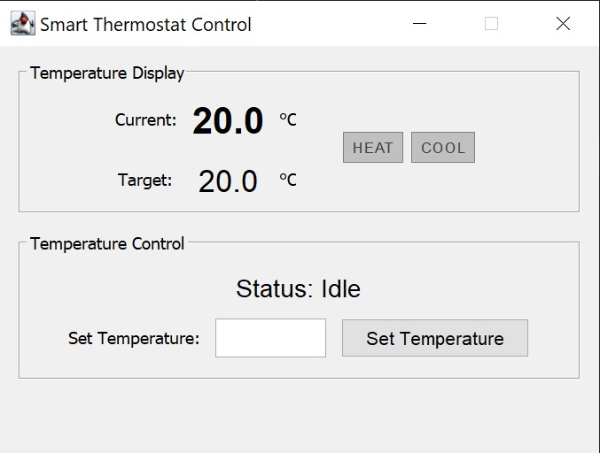
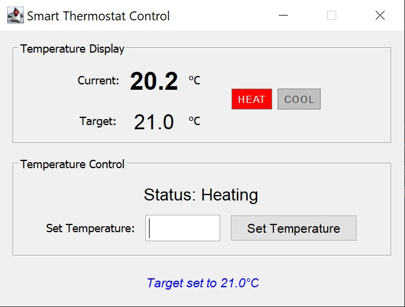
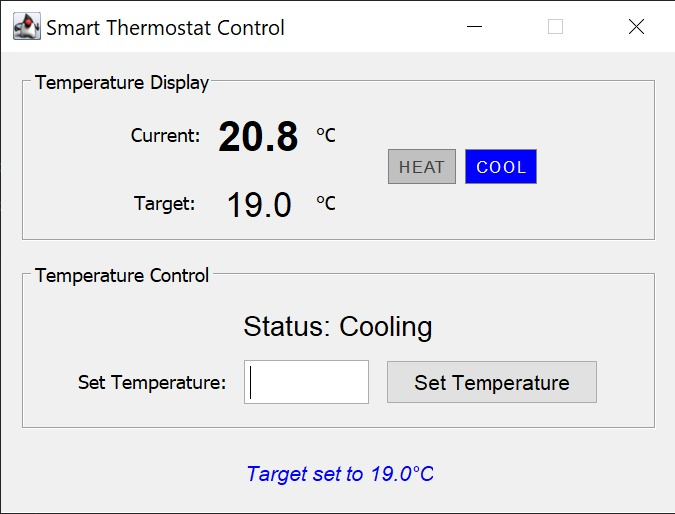
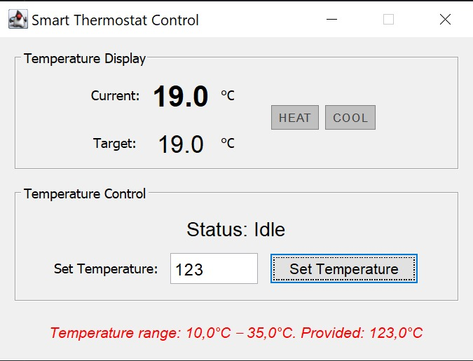

# Smart Thermostat

A desktop thermostat in Java Swing. You set a temperature, and the room heats or cools toward it by 0.1 °C every second.

I built it to practice MVC and testing with mocks.

| Idle | Heating |
|:---:|:---:|
|  |  |
| **Cooling** | **Error** |
|  |  |

## How it works

- **Model** knows the current temperature and the target, and decides whether to heat or cool. It doesn't know the window exists.
- **View** is the Swing window. It only shows what it's given.
- **Controller** is the only part that acts. It tells the model what to do, asks it for values, and passes them to the view.

The controller does two separate jobs.

**When you press Set** (once):

1. The view hands the typed text to the controller.
2. The controller calls `model.setTargetTemperature(21)`.
3. The model checks the value (10–35, 0.1 steps) and saves it as the target. The current temperature doesn't change yet.

**Every second** (a Swing `Timer` in the controller; it never stops):

1. The controller calls `model.updateSystem()`, and the model takes one step: +0.1 if too cold, −0.1 if too hot, nothing if at the target.
2. The controller asks the model for the current temperature, the target, and whether it's heating or cooling.
3. The controller passes those to `view.updateDisplay(...)`.

The model never sends anything on its own. It only answers when the controller asks.

All three are connected through interfaces. That's what lets the tests swap in a fake model and a fake view.

## Requirements

- **JDK 17 or newer**
- **JUnit 5** for tests, already in `lib/`

## Run

In PowerShell, from the project folder:

```powershell
javac -d bin (Get-ChildItem -Recurse src/main -Filter *.java).FullName
java -cp bin main.ThermostatApp
```

## Using it

The room starts at 20.0 °C. Type a target between 10 and 35 and press **Set Temperature**. `21.5` and `21,5` both work.

Only 0.1 °C steps are accepted, so `20.55` is rejected, and so are `50` and `abc`.

## Tests

Compile first:

```powershell
javac -d bin -cp lib/junit-platform-console-standalone-1.11.4.jar (Get-ChildItem -Recurse src -Filter *.java).FullName
```

All tests:

```powershell
java -jar lib/junit-platform-console-standalone-1.11.4.jar execute -cp bin --scan-classpath
```

One test:

```powershell
java -jar lib/junit-platform-console-standalone-1.11.4.jar execute -cp bin --select-method test.model.ThermostatModelTest#testTemperatureBoundaries
```

## Code

```
src/main/
  ThermostatApp.java    creates the model, view and controller and starts the app
  model/                temperature logic and input validation
  view/                 Swing window, plus fonts and colors in utils/StyleConfig
  controller/           button handling and the one-second timer
src/test/               model and controller tests
```
